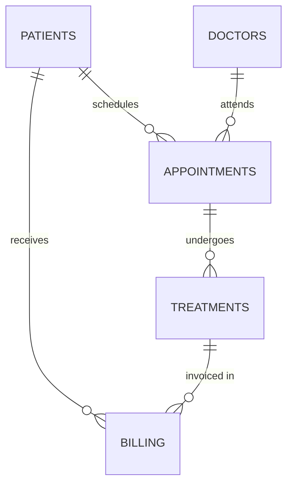

# Hospital Data Analytics Dashboard System (v3.1)
### *Predictive Revenue Forecasting, Doctor Performance Insights & Dynamic Dataset Ingestion*


---

## 📌 Project Overview

The **Hospital Data Analytics Dashboard System (v3.1)** is an enterprise-grade healthcare management analytics platform and dynamic dashboard generator. Designed to simulate real-world hospital operational, clinical, and financial intelligence systems, it transforms raw healthcare relational datasets into strategic decision-making insights.

Built for **Data Analysts, SQL Developers, BI Developers, and Healthcare Executives**, this project is portfolio-ready and tailored for technical interviews at top-tier consulting and technology firms such as **Deloitte, EY, PwC, Accenture, Microsoft, Capgemini, Infosys, TCS, and Cognizant**.

---

## ✨ Key Features

- 📂 **Dynamic Dataset Manager**:
  - Drag-and-drop file uploader accepting **CSV** (`.csv`) and **Excel** (`.xlsx`) files.
  - Real-time pre-import data validation checking required columns, primary key uniqueness, empty IDs, date formats, and numeric types.
  - Instant Data Preview Modal displaying row/column metrics, missing values, duplicates, and first 10 sample records.
  - Downloadable template sample CSVs for all tables.
  - Audit history log tracking past dataset uploads.
- ⚡ **Zero-Reload Real-Time Analytics Refresh**:
  - Automatically rebuilds database models and updates all 10 dashboard modules without requiring a browser refresh or manual file copying.
- 📊 **10 High-Density Analytics Modules**:
  - Executive Overview, Patient Analytics, Doctor Performance, Appointments, Financials & Forecast, Treatments, Diseases, Operations & Beds, AI Scenario Analytics, and Dataset Manager.
- 🧮 **Advanced SQL Analytical Suite**:
  - 40+ enterprise SQL queries using `INNER/LEFT/RIGHT JOINs`, `GROUP BY/HAVING`, Window Functions (`DENSE_RANK()`, `AVG() OVER`, `LAG()`), CTEs, Views, and Stored Procedures.
- 🤖 **AI Smart Narrative & What-If Capacity Simulator**:
  - Dynamic AI executive narrative generation and interactive slider predicting revenue and wait-time impacts of doctor capacity scaling.
- 📐 **Power BI Star Schema & DAX Library**:
  - Complete Star Schema dimensional data model with 50+ production DAX measures.

---

## 📂 Repository Folder Structure

```text
Hospital-Data-Analytics-Dashboard/
│
├── assets/                  # Design assets, logos, and UI badges
├── data/                    # Dynamic JSON data store & CSV tables
│   ├── samples/             # Downloadable sample CSV templates
│   └── uploads/             # Directory for custom user uploads
├── dax/                     # Power BI DAX measure library (.dax)
├── docs/                    # Technical documentation
│   ├── ARCHITECTURE.md      # System architecture & sequence diagrams
│   ├── ERD.md               # Entity Relationship Diagram & Data Dictionary
│   ├── SQL_DOCUMENTATION.md # SQL Window functions, CTEs & Views reference
│   ├── API_DOCUMENTATION.md # Flask REST API endpoint documentation
│   ├── DOCUMENTATION.md     # Full system technical specification
│   └── INTERVIEW_PREP.md    # 25+ interview Q&As & resume bullet points
├── public/                  # Web Dashboard Front-End
│   ├── css/
│   │   └── styles.css       # Medical dark-theme & glassmorphism UI styles
│   ├── js/
│   │   └── app.js           # Core JS logic, Chart.js rendering, API handlers
│   └── index.html           # Single-page web application entry point
├── screenshots/             # High-resolution dashboard UI screenshots
│   └── README.md            # Visual guide & screenshot placeholders
├── scripts/                 # Python ETL & synthetic data generator
│   ├── etl_import_csv.py    # CSV/Excel ingestion ETL pipeline
│   ├── generate_data.py     # 10k+ synthetic healthcare record generator
│   └── create_samples.py    # Template CSV generator
├── sql/                     # MySQL Relational Database Scripts
│   ├── 01_schema_ddl.sql    # DDL script (Tables, Keys, Constraints, Indexes)
│   ├── 02_data_inserts.sql  # DML insert statements
│   └── 03_advanced_sql_queries.sql # CTEs, Window functions & SPs
├── .gitignore               # Standard git ignore configuration
├── installation.md          # Comprehensive installation & deployment guide
├── LICENSE                  # MIT License
├── README.md                # Project documentation (You are here)
├── requirements.txt         # Python package dependencies
└── server.py                # Python Flask REST API Server
```

---

## 🛠️ Technology Stack

| Layer | Technology | Usage |
|---|---|---|
| **Database** | MySQL 8.0+ | Relational schema, Primary/Foreign keys, Views, Stored Procedures |
| **Backend REST API** | Python 3.9+ / Flask | Upload APIs, validation engine, JSON builder, static file server |
| **ETL & Data Engine** | Pandas, OpenPyXL, PyMySQL | Data cleaning, validation, synthetic data generation |
| **Front-End UI** | HTML5, Vanilla CSS3 | Custom dark medical design system, glassmorphism, responsive grid |
| **Visualizations** | Chart.js 4.x | Interactive revenue trends, doughnut charts, bar charts, scatter plots |
| **Icons & Typography** | FontAwesome 6, Google Fonts | Inter & Outfit typography, healthcare iconography |
| **BI Data Modeling** | Power BI Desktop / DAX | Star schema data warehouse model, 50+ DAX measures |

---

## 🗄️ Dataset Architecture & ER Diagram

The system operates on 5 core relational tables:
1. `patients.csv`: Demographic records, registration dates, insurance providers.
2. `doctors.csv`: Medical specialties, clinical experience, hospital branch locations.
3. `appointments.csv`: Scheduled visits, visit reasons, appointment statuses.
4. `treatments.csv`: Clinical procedure details, treatment types, costs.
5. `billing.csv`: Invoices, billed amounts, payment methods, payment statuses.



---

## 💡 Advanced SQL Features & Analytical Suite

The system includes over **40+ production-grade SQL queries** in `sql/03_advanced_sql_queries.sql`.

### Example 1: Doctor Revenue Ranking using `DENSE_RANK()`
```sql
WITH DoctorRevenue AS (
    SELECT 
        d.doctor_id,
        CONCAT(d.first_name, ' ', d.last_name) AS doctor_name,
        d.specialization,
        d.hospital_branch,
        COUNT(DISTINCT a.appointment_id) AS total_appointments,
        SUM(b.amount) AS total_revenue
    FROM doctors d
    INNER JOIN appointments a ON d.doctor_id = a.doctor_id
    INNER JOIN billing b ON a.patient_id = b.patient_id
    WHERE a.status = 'Completed' AND b.payment_status = 'Paid'
    GROUP BY d.doctor_id, doctor_name, d.specialization, d.hospital_branch
)
SELECT 
    doctor_name,
    specialization,
    total_revenue,
    DENSE_RANK() OVER (PARTITION BY specialization ORDER BY total_revenue DESC) AS spec_rank
FROM DoctorRevenue;
```

---

## 🖥️ Dashboard Visuals & Screenshots

| Executive Dashboard Overview | Dataset Manager & Upload UI |
|:---:|:---:|
|  |  |

| Doctor Performance & Leaderboard | Financials & Predictive Forecast |
|:---:|:---:|
|  |  |

---

## 🚀 Quick Start & Installation Guide

For detailed step-by-step setup, see [installation.md](installation.md).

### 1. Clone the repository
```bash
git clone https://github.com/your-username/Hospital-Data-Analytics-Dashboard.git
cd Hospital-Data-Analytics-Dashboard
```

### 2. Install dependencies
```bash
pip install -r requirements.txt
```

### 3. Setup MySQL Database
```sql
CREATE DATABASE hospital_analytics_db;
```
```bash
mysql -u root -p hospital_analytics_db < sql/01_schema_ddl.sql
mysql -u root -p hospital_analytics_db < sql/02_data_inserts.sql
mysql -u root -p hospital_analytics_db < sql/03_advanced_sql_queries.sql
```

### 4. Run the REST API Server & Web Dashboard
```bash
python server.py
```

Open your browser and navigate to 👉 **`http://localhost:8080`**

---

## 📤 Git Commands for Publishing to GitHub

```bash
# Initialize git repository
git init

# Stage all files
git add .

# Initial commit
git commit -m "Initial commit - Hospital Data Analytics Dashboard v3.1"

# Rename default branch to main
git branch -M main

# Add your GitHub remote repository
git remote add origin https://github.com/your-username/Hospital-Data-Analytics-Dashboard.git

# Push to GitHub
git push -u origin main
```

---

## 🔮 Future Enhancements

- 🔒 **User Authentication & Role-Based Access Control (RBAC)** (Admin, Physician, Billing Specialist).
- ☁️ **Cloud Deployment Integration** (Azure App Service / AWS Elastic Beanstalk + Managed MySQL).
- 📈 **Machine Learning Revenue Forecasting** (Integration of Prophet / ARIMA model into Flask backend).
- 📱 **Mobile Responsive App View** (React Native / Progressive Web App extension).

---

## 👨‍💻 Author & Contact

**Data Analytics & Engineering Portfolio Project**  
- **Role**: Senior Data Analyst / SQL Developer / Full Stack BI Engineer  
- **Target Roles**: Data Analyst, Senior Data Analyst, BI Engineer, Analytics Consultant  
- **Documentation & Interview Guide**: See [docs/INTERVIEW_PREP.md](docs/INTERVIEW_PREP.md)

---

## 📄 License

This project is open-source and licensed under the **[MIT License](LICENSE)**.
