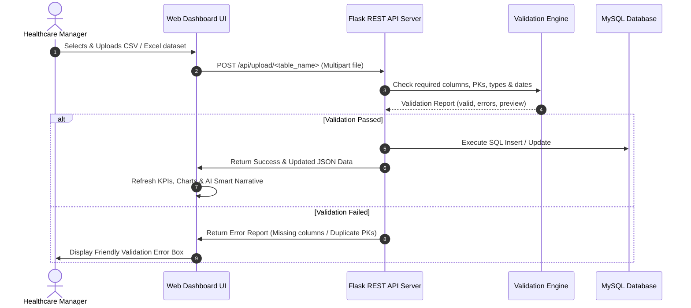

# System Architecture & Technical Specifications

## 📐 System Architecture Overview

```mermaid
flowchart TB
    subgraph Client["Front-End Web Client (HTML5 / Vanilla CSS / JS)"]
        UI["High-Density UI (Dark Theme)"]
        Charts["Chart.js Visualizations"]
        DSManager["📂 Dataset Manager (Drag & Drop UI)"]
    end

    subgraph Backend["Python Flask REST API (server.py)"]
        API["REST Endpoints (/api/upload, /api/data, /api/import)"]
        Validator["Validation & Parsing Engine (pandas / openpyxl)"]
        ETL["JSON & SQL Insert Generator"]
    end

    subgraph Storage["Database & File System"]
        JSONStore["data/hospital_data.json"]
        MySQLDB[("MySQL 8.0 Database (hospital_analytics_db)")]
        Uploads["data/uploads/"]
    end

    UI <--> API
    DSManager -->|CSV / XLSX Upload| API
    API --> Validator
    Validator --> ETL
    ETL --> JSONStore
    ETL --> MySQLDB
    Charts <-- Fetch Dataset JSON -- API
```

---

## 🔄 Data Flow Diagram (DFD)



---

## 🛠️ Technology Stack Detail

| Component | Technology | Purpose |
|---|---|---|
| **Database** | MySQL 8.0+ | Relational data persistence, Views, SPs, CTEs, Window Functions |
| **Backend API** | Python 3.9+ / Flask | REST endpoints, CSV/Excel parsing, validation engine, static file serving |
| **Data Science / ETL** | Pandas, OpenPyXL, PyMySQL | Data cleaning, data generation, batch imports |
| **Front-End UI** | HTML5, Vanilla CSS3 | Custom dark medical theme, glassmorphism, responsive single-screen layout |
| **Visualizations** | Chart.js 4.x | Line charts, Bar charts, Doughnut charts, Pie charts |
| **Icons & Typography** | FontAwesome 6, Google Fonts | Inter & Outfit typography, medical iconography |
| **BI Tooling** | Power BI Desktop | DAX measure library, Star Schema data modeling (optional) |
