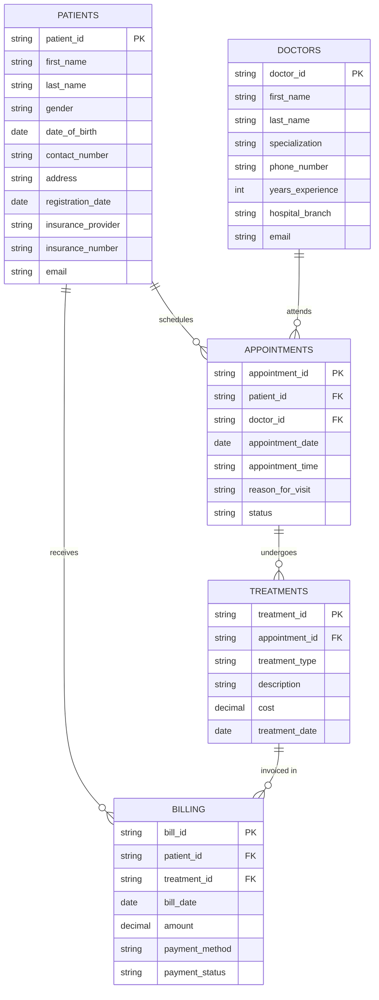

# Entity Relationship Diagram (ERD) & Data Dictionary

## 📊 Database ER Diagram

---

## 📖 Data Dictionary

### 1. `patients` Table
| Column Name | Data Type | Key | Description |
|---|---|---|---|
| `patient_id` | VARCHAR(20) | PK | Unique identifier for patient (e.g. PAT-001) |
| `first_name` | VARCHAR(50) | - | Patient first name |
| `last_name` | VARCHAR(50) | - | Patient last name |
| `gender` | VARCHAR(10) | - | Male / Female |
| `date_of_birth` | DATE | - | Birth date (YYYY-MM-DD) |
| `contact_number` | VARCHAR(20) | - | Phone number |
| `address` | VARCHAR(255) | - | Residential city / address |
| `registration_date` | DATE | - | Hospital registration date |
| `insurance_provider` | VARCHAR(100) | - | Insurance provider company |
| `insurance_number` | VARCHAR(50) | - | Insurance policy number |
| `email` | VARCHAR(100) | - | Email address |

### 2. `doctors` Table
| Column Name | Data Type | Key | Description |
|---|---|---|---|
| `doctor_id` | VARCHAR(20) | PK | Unique doctor identifier (e.g. DOC-001) |
| `first_name` | VARCHAR(50) | - | Doctor first name |
| `last_name` | VARCHAR(50) | - | Doctor last name |
| `specialization` | VARCHAR(100) | - | Medical specialty (Cardiology, Orthopedics, etc.) |
| `phone_number` | VARCHAR(20) | - | Contact phone |
| `years_experience` | INT | - | Clinical experience in years |
| `hospital_branch` | VARCHAR(100) | - | Branch location |
| `email` | VARCHAR(100) | - | Professional email |

### 3. `appointments` Table
| Column Name | Data Type | Key | Description |
|---|---|---|---|
| `appointment_id` | VARCHAR(20) | PK | Unique appointment identifier |
| `patient_id` | VARCHAR(20) | FK | Foreign key to `patients.patient_id` |
| `doctor_id` | VARCHAR(20) | FK | Foreign key to `doctors.doctor_id` |
| `appointment_date` | DATE | - | Scheduled appointment date |
| `appointment_time` | TIME | - | Scheduled time |
| `reason_for_visit` | VARCHAR(255) | - | Chief complaint / symptom |
| `status` | VARCHAR(20) | - | Completed, Scheduled, No-show, Cancelled |

### 4. `treatments` Table
| Column Name | Data Type | Key | Description |
|---|---|---|---|
| `treatment_id` | VARCHAR(20) | PK | Unique treatment identifier |
| `appointment_id` | VARCHAR(20) | FK | Foreign key to `appointments.appointment_id` |
| `treatment_type` | VARCHAR(100) | - | Procedure / Consultation / Surgery |
| `description` | TEXT | - | Detailed clinical description |
| `cost` | DECIMAL(10,2) | - | Procedure cost |
| `treatment_date` | DATE | - | Date procedure was conducted |

### 5. `billing` Table
| Column Name | Data Type | Key | Description |
|---|---|---|---|
| `bill_id` | VARCHAR(20) | PK | Unique billing record identifier |
| `patient_id` | VARCHAR(20) | FK | Foreign key to `patients.patient_id` |
| `treatment_id` | VARCHAR(20) | FK | Foreign key to `treatments.treatment_id` |
| `bill_date` | DATE | - | Invoice date |
| `amount` | DECIMAL(10,2) | - | Billed amount |
| `payment_method` | VARCHAR(50) | - | Cash, Credit Card, Insurance, UPI |
| `payment_status` | VARCHAR(20) | - | Paid, Pending, Refunded |
